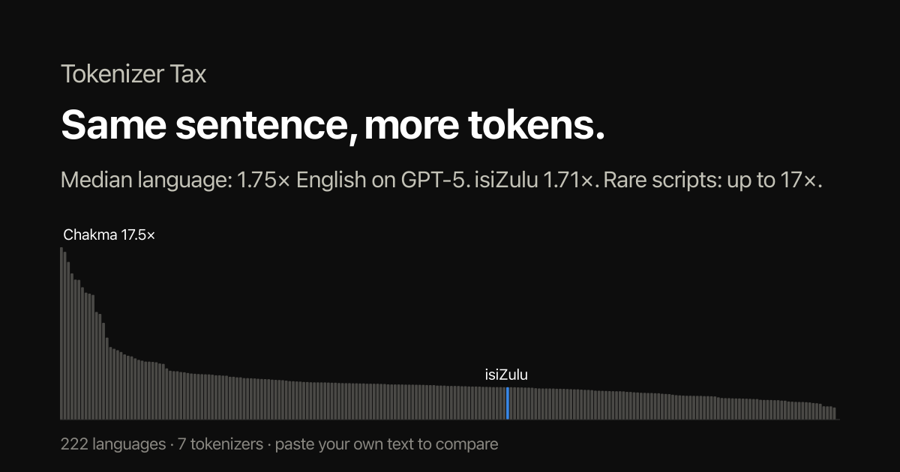

# Tokenizer Tax

**The same sentence costs more tokens in some languages than others. Here is how much more.**

LLM APIs charge per token. A tokenizer trained mostly on English splits other languages into more,
smaller pieces, so the same message costs more, fills the context window faster and runs slower.
Tokenizer Tax measures that gap for **222 languages** on the tokenizers behind today's models, and lets
you check your own text.

**[Try it: anri-lombard.github.io/tokentax](https://anri-lombard.github.io/tokentax)**

<p align="center"></p>

## What you can do with it

- **Paste your text** and see the token count on every tokenizer, which one is cheapest for it, and your
  monthly cost at your own volume and prices. Tokenization runs in your browser; nothing is uploaded.
- **See where the tokens go.** Each token is shaded, and characters the tokenizer never learned show how
  many byte-level tokens they cost.
- **Look up your language**: how many times more tokens it needs than English, on each tokenizer.
- **Measure your own tokenizer** against the big ones on all 222 languages (below).

## Findings (FLORES+ devtest, October 2026)

| | GPT-5 / 4o | GPT-4 (2023) | Qwen3.8 | DeepSeek-V4.1 | GLM-5.3 | Mistral Medium 3.5 | Gemma 4 |
|---|---|---|---|---|---|---|---|
| Median language | 1.75× | 2.27× | 1.94× | 2.08× | 2.07× | 1.94× | 1.85× |
| isiZulu | 1.71× | 2.20× | 2.10× | 2.18× | 2.17× | 2.09× | 1.97× |
| Hindi | 1.57× | 4.76× | 2.01× | 2.79× | 4.31× | 1.80× | 1.31× |
| Amharic | 5.78× | 7.59× | 4.38× | 5.97× | 7.59× | 7.43× | 1.94× |

- **Script matters more than language.** The worst cases (Chakma 17×, traditional Mongolian 16×, Ol Chiki,
  N'Ko, Tifinagh) are scripts the tokenizers barely saw, so every character is spelled out byte by byte.
- **No tokenizer wins everywhere.** GPT-5's has the lowest median tax; Gemma 4's is far better for Ethiopic,
  Indic and Tifinagh scripts (Amharic 1.9× vs 5.8× on GPT-5, Tamazight 4.5× vs 10.2×).
- **It is getting better.** GPT-4's 2023 tokenizer charged Hindi 4.8×; GPT-5's charges 1.6×.

## Command line

```bash
uvx --from git+https://github.com/Anri-Lombard/tokentax tokentax "Sawubona, unjani namhlanje?"
```

```
                      tokens  chars/token
GPT-5 / GPT-4o            10         2.70
GPT-4 (2023)              13         2.08
Qwen3.8                   13         2.08
DeepSeek-V4.1             12         2.25
GLM-5.3                   13         2.08
Mistral Medium 3.5        12         2.25
Gemma 4                   11         2.45
```

Pass a file or `-` for stdin, and `--vs english.txt` with the same text in English to get the tax directly.

### Measure your own tokenizer

Training a tokenizer for your language or model? Score it on all 222 languages, next to the big ones:

```bash
tokentax eval path/to/tokenizer.json --lang zul_Latn,xho_Latn,afr_Latn
tokentax eval your-org/your-model          # any Hugging Face repo with a tokenizer.json
```

It prints the median tax, the share of languages under 1.5× and 2×, the worst language, and English's
absolute token count. A low tax from a tokenizer that is simply bad at English isn't a win, so check both.
`eval` needs the FLORES+ text: accept its terms on
[Hugging Face](https://huggingface.co/datasets/openlanguagedata/flores_plus) and run `hf auth login` once.

## How it's measured

Each language's tax is the number of tokens a tokenizer needs for the 1,012 FLORES+ devtest sentences,
divided by the tokens the same tokenizer needs for the English versions of those sentences. Every language
says the same thing, so the difference is the tokenizer. Rebuild the data with
`uv run --group data scripts/build_data.py`.

Not covered yet: Claude and Gemini (their tokenizers are only available through their APIs), Llama (gated)
and Kimi (no `tokenizer.json`).

## Credits

- Text: [FLORES+](https://huggingface.co/datasets/openlanguagedata/flores_plus) by OLDI, CC BY-SA 4.0.
  Only token counts are published here.
- Prior work: Petrov et al., [Language Model Tokenizers Introduce Unfairness Between Languages](https://arxiv.org/abs/2305.15425)
  (NeurIPS 2023); Ahia et al., [Do All Languages Cost the Same?](https://arxiv.org/abs/2305.13707) (EMNLP 2023).
- Playground samples: Universal Declaration of Human Rights, Article 1 (UN OHCHR translations).
- In-browser tokenizers: [js-tiktoken](https://github.com/dqbd/tiktoken) and [tokenizers.js](https://github.com/huggingface/tokenizers.js).

MIT licensed.
